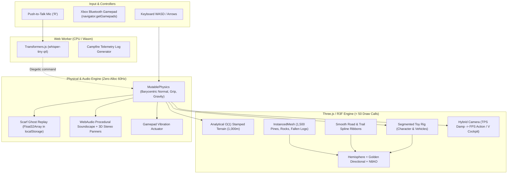
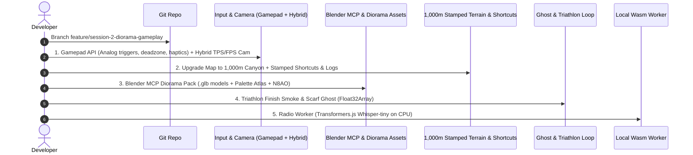

# Boreal Flow — Session 2 & 2.5 Specification & Architecture Roadmap

> **Branch:** `feature/session-2-diorama-gameplay`  
> **Repository:** [https://github.com/QuentinMerle/boreal-flow](https://github.com/QuentinMerle/boreal-flow)  
> **Focus:** Diorama aesthetic polish, Blender MCP pipeline, 1,600m map scale, analog gamepad feel, procedural Web Audio ASMR, zero-HUD gameplay loop, and Expedition Field Guide UI.

---

## 1. Executive Summary & Core Evolution

In Session 1, we established the **287 kB procedural proof-of-concept**: $O(1)$ heightfield physics, 4 movement states (`WALK`, `LONGBOARD`, `BIKE`, `CANOE`), procedural audio synthesis, day/night cycles, and basic articulated rig.

In Session 2 and Session 2.5, we elevated this technical foundation into an **authentic, tactile indie game experience**:
1. **Map Scale Upgrade (1,600m Descent):** Tripled the course length ($Z = -800$ to $+800$, altitude drop of 335m) with the upper "Red Bull Rampage" sandstone couloirs and crags (`RAMPAGE_OCHRE`), middle forest singletracks, and lakeside finish.
2. **From Primitives to "Diorama Clay" Assets:** Blender 5.2 modeling of `campsite.glb` (A-frame canvas tent, split cedar log bench, stone fire pit) with custom GLSL dancing campfire flames.
3. **Organic Stylized Smoke Plume:** 64-puff icosahedral plume with thermal convection swirl, sinusoidal billow scale envelope (no popping on loop), and 3-stage warm hearth to sky mist gradient.
4. **Procedural Web Audio Soundscape Expansion:**
   - Resonant bandpass aerodynamic wind whistle (450–1600 Hz) surging at 40–90 km/h.
   - Cozy campfire crackling and resonant wood fiber ember pops (1600–3800 Hz) within 22m of the fire pit.
5. **Physical Game Feel & Camera Calibration:**
   - Removal of artificial blob shadow under player (relying exclusively on crisp 2048px real-time directional shadow map).
   - Dual-mode camera: Elevated Diorama view (10.5–14.5m, ~38° pitch) for course readability + Close 3rd-person "Skate / Action" camera on `[V]`.
   - Canoe rebalance: sprint capped at 28 km/h, authentic 4.8 m/s² paddling strokes, hydrodynamic fluid drag.
   - Micro-vibration road rumble smoothed by 3x (amplitude 0.026).
6. **Expedition Field Guide UI / UX:** High-polish pause overlay with tactile Trailhead cards, segmented sky bar, collectible wildlife badges, and physical keycaps/gamepad badges.

---

## 1.5 Session 2.5 Changelog & Playtest Observations

### Ce qui a été réalisé en Session 2.5 (Completed ✅)
- [x] **Suppression de l'ombre factice (Blob Shadow) :** Retrait du mesh `blobShadow` sous le joueur ; l'ombre portée directionnelle en temps réel (shadow map Three.js 2048px) prend le relais pour un contact au sol naturel.
- [x] **Caméra par défaut réhaussée (Diorama Surplomb) :** Élévation à 10,5–14,5 m avec inclinaison de ~38° vers l'avant (façon *Lonely Mountains: Downhill*) pour anticiper les virages et obstacles. La vue proche "Skate" reste disponible sur `[V]`.
- [x] **Rééquilibrage physique du Canoë :** Vitesse max plafonnée à 28 km/h en sprint (croisière 15–18 km/h), accélération réduite de 21 m/s² à 4,8 m/s², traînée visqueuse accrue sur l'eau (fini les pointes involontaires à 70 km/h).
- [x] **Adoucissement du shake de vitesse :** Amplitude divisée par plus de 3 (`0.026` au lieu de `0.095`) et fréquences lissées (22–28 Hz) pour un grondement d'asphalte subtil.
- [x] **Fumée de feu de camp organique :** 64 bouffées icosaédriques avec enveloppe d'échelle en cloche (0,3 m $\to$ 4,5 m $\to$ résorption douce dans le ciel), vortex thermique hélicoïdal et gradient 3 couleurs (ambre braise $\to$ crème marshmallow $\to$ brume d'altitude).
- [x] **Ambiance sonore Web Audio procédurale :** Sifflement aérodynamique haute vitesse (filtre bandpass résonant au-delà de 40 km/h) et claquements de braises / crépitements aléatoires près du bivouac.
- [x] **Texture & Shader d'herbe procédural :** Shading procédural multi-échelle injecté dans le terrain (micro-stippling de brins, patchs de trèfle émeraude et de fétuque dorée, et sheen velouté au soleil), couplé à 5 200 touffes d'herbe instanciées 3 lames à gradient racinaire animées par le vent.
- [x] **Refonte complète de l'UI Pause ("Expedition Field Guide") :** Grille de cartes Trailhead tactiles avec code couleur par discipline, barre météo segmentée, badges d'espèces découvrables et touches clavier/manette sous forme de keycaps `<kbd>`.

### Observations de Jeu & Retours d'Expérience (Playtest Findings)
1. **Flux de descente & blocage en montée :**
   - *Constat :* Lorsque le joueur rate une épingle et fait demi-tour, il se retrouve face à la pente et la gravité l'immobilise.
   - *Analyse :* Dans *Lonely Mountains*, le tracé est conçu pour n'offrir aucun faux-plat montant. Le terrain doit guider naturellement le joueur vers l'aval (profil en cuvette / entonnoir).
2. **Aspect plat de l'herbe du terrain :**
   - *Constat :* L'herbe en couleur de vertex unique par triangle manque de matière et de texture sur les grandes étendues.
   - *Analyse :* Un shader de stippling/dither 2 tons avec détection de pente (roche calcaire automatique sur les pentes raides) apportera de la profondeur visuelle sans coût GPU.
3. **Sentiment de solitude / Besoin de vie :**
   - *Constat :* La carte de 1 600m est grandiose mais manque d'animation vivante en dehors du joueur et des oiseaux statiques.
   - *Analyse :* L'intégration d'animaux 3D réactifs (orignal au lac, ours sur le canyon, lièvre détalant) et d'un combi van rétro sur la route asphaltée (avec aspiration/drafting) rendra le monde vivant et vibrant.

---

## 1.6 Roadmap Session 3 — Backlog Prioritaire

### Chantier 1 : Game Design Pure & Flow "Lonely Mountains"
- [ ] **Profil de piste en cuvette (Funneling) :** Ajuster le relief aux abords des épingles pour empêcher les sorties de piste incontrôlées et canaliser la trajectoire vers l'aval.
- [ ] **Touche de Restart / Checkpoint instantané `[R]` :** Snapper immédiatement le joueur 50 m en amont sur le tracé officiel à bonne allure en cas de blocage ou crash.
- [ ] **Tunnels de canopée (Ombre mouchetée) :** Branches basses au-dessus du singletrack créant des bandes d'ombres au sol décuplant la vitesse perçue.
- [ ] **Passerelles North Shore en bois :** Pontons surélevés et virages en lattes de bois au-dessus des ruisseaux avec claquement audio des pneus (`tac-tac`).
- [ ] **Gap Jumps de coupe-virage :** Kickers naturels permettant de sauter par-dessus le vide pour couper les lacets au chrono.
- [ ] **Ondulations de freinage (Braking bumps) :** Vibrations rythmiques du terrain avant les gros virages.

### Chantier 2 : Shading & Texturation du Terrain / Herbe (Completed ✅)
- [x] **Custom Terrain Shader (Dither & Stippling) :**
  - Modulation procédurale multi-échelle (micro-stippling de brins, patchs de trèfle émeraude et fétuque alpine dorée).
  - Reflet anisotrope velouté au soleil (*velvety sun sheen* avec translucidité de canopée).
  - Zéro coût de texture (calculé 100% sur le GPU, 0 draw call additionnel).
- [x] **Touffes d'herbe instanciées 3D (3 lames fannées) :** 5 200 touffes le long des sentiers et rives avec géométrie 3 lames incurvées, gradient racinaire (sol sombre $\to$ vert mousse $\to$ pointe ensoleillée) et animation de vent fluide via `injectWindShader`.

### Chantier 3 : Vie dans le Parc (Faune & Trafic)
- [ ] **Modèles Blender 3D Low-Poly :**
  - **Orignal (Moose) :** Au bord des roseaux du lac, relève la tête au passage du joueur.
  - **Ours noir :** Sur le flanc ouest du canyon près des buissons de myrtilles.
  - **Lièvre d'Amérique :** Traverse le sentier devant le vélo et détale dans un tronc d'arbre.
- [ ] **Combi Van Canadien Rétro sur la Route :**
  - Véhicule autonome suivant la spline `asphaltCurve` à 25–30 km/h.
  - Mécanique d'aspiration (drafting) en Longboard pour gain de vitesse.
  - Klaxon / réaction à la sonnette `[C]`.

### Chantier 4 : Scarf Ghost & Time Trial Recap
- [ ] **Scarf Ghost System ("Fantôme d'Écharpe") :** Enregistrement de trajectoire `Float32Array(900 * 5)` dans `localStorage` pour rejouer son meilleur chrono.
- [ ] **Carte récapitulative d'arrivée :** Affichage d'un panneau en bois sculpté avec temps final, badge débloqué (Érable, Geai, Orignal) et vitesse de pointe.

### Chantier 5 : On-Device AI (Transformers.js)
- [ ] **Web Worker Wasm CPU (`whisper-tiny`) :** Push-to-talk talkie-walkie sans latence GPU pour réactions diégétiques du monde.

---

## 2. Antigravity Model Selection Strategy

To maximize architectural depth and code reliability while preserving AI quotas:

| Model | Recommended Tasks | Key Strengths |
| :--- | :--- | :--- |
| **Gemini 4 Argon (High)** | • Complex 3D math & physics ($O(1)$ heightfield, CatmullRom splines, orthonormal basis matrices) • Custom GLSL vertex shaders (`onBeforeCompile`) • Blender MCP Python procedural modeling scripts (`bmesh`) • Large multi-file architectural refactorings & engine core changes | Deep reasoning, zero-shot mathematical accuracy, robust spatial logic. |
| **Gemini 3.8 Flash (High)** | • Rapid gameplay feel tuning (friction constants, camera spring damping) • Gamepad API event listeners & input deadzone mapping • HUD overlay styling & DOM direct telemetry updates • Git commits, branch management & roadmap documentation tracking • Scoped bugfixes & quota conservation | Ultra-fast execution, minimal quota burn, high code precision on focused edits. |

---

## 3. Architecture Diagram (Session 2 Target)

---

## 4. Detailed Work Packages

### WP 1 — 2.5D Isometric Icon Factory ("Usine à Icônes++")
- [ ] **Blender MCP Render Studio:**
  - Orthographic camera with dimetric 2:1 angle: Euler rotation `(X: 60°, Y: 0°, Z: 45°)`.
  - Resolution: `48x48px`, Eevee engine with anti-aliasing disabled (`filter_size = 0.01px`), Color Management set to `Standard`.
  - Custom material node setup: `Shader to RGB` $\to$ `ColorRamp` in `CONSTANT` mode (3 crisp luminance values).
- [ ] **Post-Processing & Spritesheet Builder:**
  - Python / Canvas script generating a 1px solid black contour (`#181425`) using 4-connectivity edge detection.
  - Horizontal spritesheet assembly of 12 frames (`576x48px`).
- [ ] **Web / CSS Integration:**
  - CSS keyframe animation using `steps(11)` forward/backward on `:hover`.
  - Real-time SVG palette swapping via `<filter id="palette-swap"><feComponentTransfer>...`:
    - Base state: Pocket Ink monochrome.
    - Hover state: Vibrant Cinnabar / Cerulean / Goldenrod themes.

### WP 2 — Art Direction & Low-Poly "Diorama Clay" Assets
- [ ] **Asset Pipeline via Blender MCP $\to$ `.glb` (Meshopt compressed):**
  - `vehicles.glb`:
    - **Mountain Bike:** Independent objects for `Frame`, `Fork_Handlebars`, `Wheel_Front`, `Wheel_Rear` centered at origin for zero-cost procedural rotation and steering.
    - **Longboard:** Drop-through deck, trucks, 4 urethane wheels.
    - **Canoe:** Classic prospector hull + separate wooden paddle.
  - `nature-pack.glb`:
    - **Boreal Pines:** 3 stacked, slightly twisted 8-sided cone clusters with faceted trunks.
    - **Rocks / Boulders:** Low-poly icospheres with `Decimate (0.3)` and flat shading.
    - **Deadfall / Fallen Logs:** Lichen-covered trunks laying across slopes and forest corridors for obstacle jumping.
  - `landmarks.glb`: Firewatch tower structure, A-frame tent, wooden docks, bird models.
  - `character.glb`: Segmented Toy Rig (8 capsule/box primitives with articulated joints, zero skeletal skinning overhead).
- [x] **Color Palette, Procedural Rig & Diorama Polish (Chantier B Completed ✅):**
  - Unified matte clay material across terrain, foliage, character, and vehicles (`roughness: 0.88 - 0.92`, zero plastic specular shine).
  - Ground Contact **Blob Shadow** under player & vehicles (dynamically scales and fades with airtime so wheels never appear to float).
  - Procedural **Spinning Wheels** (spoked VTT wheels & urethane Longboard wheels rotating with $\Delta\theta = (v / R) \cdot \Delta t$).
  - Vertex-colored **Water Shoreline Foam** & custom GPU vertex wave ripples along the canyon river and Mirror Lake.

### WP 3 — Terrain Stamping 2D & Map Scale Upgrade (1,000m Canyon Corridor)
- [x] **Map Scaling Architecture (Chantier A Completed ✅):**
  - **Dimensions:** Width $400\text{m}$ (canyon framing), Length $1,000\text{m}$ ($Z = -500$ to $+500$), Summit elevation $124\text{m}$ descending to Mirror Lake at $0\text{m}$.
  - **Grid Resolution:** $180 \times 400$ analytical grid ($\approx 144\text{k}$ low-poly triangles in a single non-indexed BufferGeometry).
  - **Vegetation Population:** Scaled to 1,350 instanced pines, 520 granite boulders, and 2,800 grass tufts (rendered in single instanced draw calls).
  - **Shadow Cost:** Zero additional GPU load (directional shadow camera follows the player in a fixed frustum).
  - **Run Length:** Full 1,000m descent with a 700m mega-zipline from the Summit Firewatch Tower.
- [x] **Spline Stamping, Kickers, River Canyon & Fallen Logs (Chantier A Completed ✅):**
  - **Main Asphalt Road:** Sweeping S-curves and hairpins (`asphaltCurve`), automatically clears vegetation, extrudes smooth dark ribbon (`#222428`) with dashed yellow centerline.
  - **VTT Singletracks & Kickers:** Forest singletrack (`dirtCurve`) that **cuts across the asphalt hairpins**, painted ochre dirt, with 4 sculpted asymmetric jump kickers (`evaluateKickerBoost`) and slope-crest airborne launch physics.
  - **Fallen Cedar Log Hurdles (`FALLEN_LOGS`):** 6 mossy cedar logs with golden lichen across the road and dirt trail requiring a well-timed Bunny-Hop / Ollie (`Space` / Gamepad `A`).
  - **Canoe Whitewater River Canyon:** Sub-$Y=0$ winding river channel (`riverCurve`) starting at the Mid-Mountain Put-In Dock ($X = 62, Z = -135$) and flowing into Mirror Lake with directional current (`getRiverCurrentVector`).

### WP 3.5 — Physique & Gameplay 2.0 ("Anti-YOLO" / Courbe de Maîtrise) (Completed ✅)
> [!IMPORTANT]
> **Objectif atteint :** Transformation du bac à sable en un vrai jeu de trajectoire et d'inertie à la *Lonely Mountains / Descenders*.
- [x] **1. Collisions Arbres & Rochers ($O(1)$ Spatial Hash) :**
  - Grille spatiale $O(1)$ (`queryObstacleCollision` dans `terrainData.ts` partagée avec `TerrainChunk.tsx`) : impact franc à haute vitesse (rebond, perte de vitesse, particules, son boisé/rocheux `triggerObstacleCrashSound()` + vibration manette) et glissement tangentiel à basse vitesse.
- [x] **2. Courbe de Braquage Liée à la Vitesse (Inertie Réelle) & Drift Exit Boost :**
  - À haute vitesse ($> 30\text{ km/h}$), le rayon de braquage se raidit naturellement avec l'inertie, obligeant à **freiner (`S` / `LT`)** ou **déclencher un Powerslide (`Shift` / `B`)** (`driftTurnBoost = 2.15`) avec relance d'accélération en sortie de slide (*Drift Exit Boost*).
- [x] **3. Propulsion Authentique par Discipline :**
  - **Longboard :** Poussée au pied rythmique (*Foot-Push* avec animation de la jambe droite + son de poussée) sous $43\text{ km/h}$ ; au-delà, prise de vitesse purement par la gravité de la pente, l'*Aero Tuck* (réduction de traînée de 42% + boost gravité +26%) et le *Carve Pumping*.
  - **VTT :** Couple de pédalage fort en relance jusqu'à $70\text{ km/h}$, puis gravité et pompage sur le singletrack.
- [x] **4. Vraie Pénalité Hors-Piste :**
  - Sortir du bitume en Longboard dans l'herbe ou la rocaille freine drastiquement les roues d'uréthane (`surfaceDragMultiplier = 6.8`) avec vibrations du plateau.

### WP 4 — Analog Gamepad Feel & Hybrid Camera
- [x] **Bluetooth Gamepad Integration (`navigator.getGamepads`):**
  - Analog steering with deadzone (`0.12`).
  - Analog triggers: RT for progressive acceleration / pedaling cadence, LT for progressive braking and powerslide initiate.
  - Button A for bunny-hops, ollies, and bouldering dynos.
  - Full button map: X (Action), Y/RB (Bell & Wave Emote), LB (Binoculars), Back (Respawn), Start (Day/Night), R3/L3 (Cockpit mode toggle), D-Pad (Mode select).
  - Haptic feedback via `gamepad.vibrationActuator`:
    - Continuous granular micro-rumble on dirt/gravel surfaces & powerslides.
    - Sharp impulse on landing squash or obstacle collisions.
    - Double pulse on bell chime and actions.
- [x] **Hybrid Camera Controller:**
  - Dynamic 3rd person follow camera (TPS) with damped springs during motion.
  - Smooth lerp to stationary contemplation camera when stopped (`speed < 0.8` for $> 1.2\text{s}$) with lower height and upward gaze towards forest canopy.
  - First-person / Handlebars Cockpit camera (Toggle `V` or Gamepad `R3/L3`) with locked roll horizon (zero roll nausea) and wide 56° downhill FOV.
  - HUD integration: Gamepad connection badge (`🎮 GAMEPAD READY`), View toggle button (`🎥 View (V)`), and updated controls guide.

### WP 5 — Zero-HUD Gameplay Loop ("Le But sans le Stress")
- [x] **The Boreal Triathlon & Diegetic Smoke Plume (Completed ✅):**
  - Summit trailhead departure arch ($Z = -188$) to lake arrival arch ($Z = 106$).
  - Visible diegetic landmark: 50m vertical column of white campfire smoke rising above the forest canopy with natural wind sway and golden hour tint.
  - Complete freedom of route: automatic multi-sport chaining tracking (`Longboard`, `Bike`, `Canoe`).
  - Automated run timing and tier badges: 🍁 **Feuille d'Érable** (Gold $< 50\text{s}$), 🪶 **Plume de Geai** (Silver $< 75\text{s}$), 🦌 **Bois d'Orignal** (Bronze).
  - Triumphant pentatonic finish fanfare, gamepad haptic celebration, personal best persistence in `localStorage`.
- [ ] **Scarf Ghost System ("Fantôme d'Écharpe"):**
  - Pre-allocated `Float32Array(900 * 5)` telemetry recorder (recording position, yaw, and mode at 5Hz).
  - Persistent storage in `localStorage` for personal best replay.
  - Translucent golden silhouette and fluttering scarf rendering the ghost.
  - Carved wooden trailhead finish board displaying rankings (Maple Leaf, Jay Feather, Moose Antlers).
- [ ] **Ranger Field Activities:**
  - Auditory navigation via spatialized `StereoPannerNode` beacons.
  - Lighting hilltop beacon braziers.
  - Wildlife identification and field notebook completion.

### WP 6 — Local On-Device AI (Transformers.js in Web Worker)
- [ ] **Isolated Web Worker (`radio.worker.ts`):**
  - Runs exclusively on CPU using WebAssembly (`device: 'wasm'`, `dtype: 'q4'`), preserving 100% GPU bandwidth for WebGL/Three.js.
  - Models: `whisper-tiny` (~40MB) for audio transcription.
- [ ] **Diegetic Walkie-Talkie (Push-to-Talk 'R'):**
  - Web Audio API procedural static burst and bandpass radio filter.
  - Spoken queries trigger in-world reactions (distant loon echo pointing to lake, tower lantern flash in fog, solar timelapse).
- [ ] **Campfire Telemetry Logbook:**
  - Telegraphic, impressionistic summary generated at run completion based on physical telemetry (max speed, vehicles used, airtime, weather, animals encountered).

### WP 7 — The 4 Performance Commandments ("Mac Glacé" 120 FPS)
1. **Zero Allocations in `useFrame`:** Pre-allocate module-scoped scratch vectors; no `new THREE.Vector3()` or `.clone()` in animation frames.
2. **Asset Compression:** Process all `.glb` exports through `gltf-transform optimize --compress meshopt`.
3. **Selective Shadows:** Restrict `castShadow` to pines, player, and large rocks; implement simple projected blob shadows beneath vehicle wheels.
4. **Draw Call Budget:** Monitor with `<Perf />` (`r3f-perf`) to strictly maintain $< 50$ draw calls.

---

## 5. Implementation Steps Order of Attack

