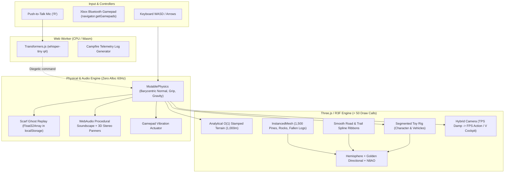
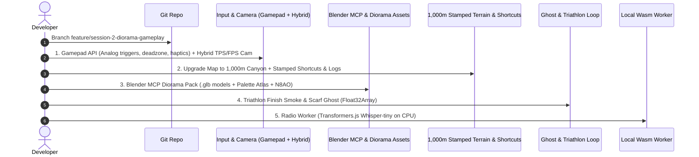

# Boreal Flow — Session 2 Specification & Architecture Roadmap

> **Branch:** `feature/session-2-diorama-gameplay`  
> **Repository:** [https://github.com/QuentinMerle/boreal-flow](https://github.com/QuentinMerle/boreal-flow)  
> **Focus:** Diorama aesthetic polish, Blender MCP pipeline, 2.5D isometric icon factory, analog gamepad feel, zero-HUD gameplay loop, and on-device local AI.

---

## 1. Executive Summary & Core Evolution

In Session 1, we established the **287 kB procedural proof-of-concept**: $O(1)$ heightfield physics, 4 movement states (`WALK`, `LONGBOARD`, `BIKE`, `CANOE`), procedural audio synthesis, day/night cycles, and basic articulated rig.

In Session 2, we elevate this technical foundation into an **authentic, tactile indie game experience**:
1. **From Primitives to "Diorama Clay" Assets:** Transitioning select procedural meshes to low-poly `.glb` models generated via **Blender MCP**, optimized via `meshopt`, sharing a single 32x32 color palette atlas and styled with warm, clay-like matte materials (`roughness: 0.9`).
2. **2.5D Isometric Icon Factory:** An automated pipeline (Blender MCP dimetric 2:1 camera $\to$ Eevee 48x48 sans-AA $\to$ ColorRamp 3 tones $\to$ 1px black outline $\to$ SVG `<feComponentTransfer>` palette swap).
3. **Lonely Mountains Terrain Stamping & Map Scale Upgrade:** Doubling the slope to a **1,000m canyon descent** with analytical $O(1)$ elevation, while carving technical VTT singletrack shortcuts through pine forests, fallen tree hurdle jumps, and an organic river canyon beneath the $Y=0$ water plane.
4. **Physical Game Feel & Xbox Controller:** Native Bluetooth Gamepad API integration with analog triggers, deadzones, and dual-rumble haptic feedback (`vibrationActuator`).
5. **Zero-HUD Gameplay Loop ("Le But sans le Stress"):**
   - **Boreal Triathlon:** Summit to lake shore marked by a smoke plume above the canopy.
   - **Scarf Ghost ("Fantôme d'Écharpe"):** Pre-allocated `Float32Array(900 * 5)` ghost run recorder in `localStorage`.
   - **Ranger Missions:** Auditory landmarks and ridge beacon lighting.
6. **Local On-Device AI (Transformers.js in Web Worker):**
   - Push-to-talk Walkie-Talkie on CPU Wasm (`whisper-tiny` ~40MB) driving diegetic in-game reactions without cloud latency.
   - Telegraphic campfire telemetry field notes.

---

## 2. Antigravity Model Selection Strategy

To maximize architectural depth and code reliability while preserving AI quotas:

| Model | Recommended Tasks | Key Strengths |
| :--- | :--- | :--- |
| **Gemini 4 Argon (High)** | • Complex 3D math & physics ($O(1)$ heightfield, CatmullRom splines, orthonormal basis matrices) • Custom GLSL vertex shaders (`onBeforeCompile`) • Blender MCP Python procedural modeling scripts (`bmesh`) • Large multi-file architectural refactorings & engine core changes | Deep reasoning, zero-shot mathematical accuracy, robust spatial logic. |
| **Gemini 3.8 Flash (High)** | • Rapid gameplay feel tuning (friction constants, camera spring damping) • Gamepad API event listeners & input deadzone mapping • HUD overlay styling & DOM direct telemetry updates • Git commits, branch management & roadmap documentation tracking • Scoped bugfixes & quota conservation | Ultra-fast execution, minimal quota burn, high code precision on focused edits. |

---

## 3. Architecture Diagram (Session 2 Target)

---

## 4. Detailed Work Packages

### WP 1 — 2.5D Isometric Icon Factory ("Usine à Icônes++")
- [ ] **Blender MCP Render Studio:**
  - Orthographic camera with dimetric 2:1 angle: Euler rotation `(X: 60°, Y: 0°, Z: 45°)`.
  - Resolution: `48x48px`, Eevee engine with anti-aliasing disabled (`filter_size = 0.01px`), Color Management set to `Standard`.
  - Custom material node setup: `Shader to RGB` $\to$ `ColorRamp` in `CONSTANT` mode (3 crisp luminance values).
- [ ] **Post-Processing & Spritesheet Builder:**
  - Python / Canvas script generating a 1px solid black contour (`#181425`) using 4-connectivity edge detection.
  - Horizontal spritesheet assembly of 12 frames (`576x48px`).
- [ ] **Web / CSS Integration:**
  - CSS keyframe animation using `steps(11)` forward/backward on `:hover`.
  - Real-time SVG palette swapping via `<filter id="palette-swap"><feComponentTransfer>...`:
    - Base state: Pocket Ink monochrome.
    - Hover state: Vibrant Cinnabar / Cerulean / Goldenrod themes.

### WP 2 — Art Direction & Low-Poly "Diorama Clay" Assets
- [ ] **Asset Pipeline via Blender MCP $\to$ `.glb` (Meshopt compressed):**
  - `vehicles.glb`:
    - **Mountain Bike:** Independent objects for `Frame`, `Fork_Handlebars`, `Wheel_Front`, `Wheel_Rear` centered at origin for zero-cost procedural rotation and steering.
    - **Longboard:** Drop-through deck, trucks, 4 urethane wheels.
    - **Canoe:** Classic prospector hull + separate wooden paddle.
  - `nature-pack.glb`:
    - **Boreal Pines:** 3 stacked, slightly twisted 8-sided cone clusters with faceted trunks.
    - **Rocks / Boulders:** Low-poly icospheres with `Decimate (0.3)` and flat shading.
    - **Deadfall / Fallen Logs:** Lichen-covered trunks laying across slopes and forest corridors for obstacle jumping.
  - `landmarks.glb`: Firewatch tower structure, A-frame tent, wooden docks, bird models.
  - `character.glb`: Segmented Toy Rig (8 capsule/box primitives with articulated joints, zero skeletal skinning overhead).
- [x] **Color Palette, Procedural Rig & Diorama Polish (Chantier B Completed ✅):**
  - Unified matte clay material across terrain, foliage, character, and vehicles (`roughness: 0.88 - 0.92`, zero plastic specular shine).
  - Ground Contact **Blob Shadow** under player & vehicles (dynamically scales and fades with airtime so wheels never appear to float).
  - Procedural **Spinning Wheels** (spoked VTT wheels & urethane Longboard wheels rotating with $\Delta\theta = (v / R) \cdot \Delta t$).
  - Vertex-colored **Water Shoreline Foam** & custom GPU vertex wave ripples along the canyon river and Mirror Lake.

### WP 3 — Terrain Stamping 2D & Map Scale Upgrade (1,000m Canyon Corridor)
- [x] **Map Scaling Architecture (Chantier A Completed ✅):**
  - **Dimensions:** Width $400\text{m}$ (canyon framing), Length $1,000\text{m}$ ($Z = -500$ to $+500$), Summit elevation $124\text{m}$ descending to Mirror Lake at $0\text{m}$.
  - **Grid Resolution:** $180 \times 400$ analytical grid ($\approx 144\text{k}$ low-poly triangles in a single non-indexed BufferGeometry).
  - **Vegetation Population:** Scaled to 1,350 instanced pines, 520 granite boulders, and 2,800 grass tufts (rendered in single instanced draw calls).
  - **Shadow Cost:** Zero additional GPU load (directional shadow camera follows the player in a fixed frustum).
  - **Run Length:** Full 1,000m descent with a 700m mega-zipline from the Summit Firewatch Tower.
- [x] **Spline Stamping, Kickers, River Canyon & Fallen Logs (Chantier A Completed ✅):**
  - **Main Asphalt Road:** Sweeping S-curves and hairpins (`asphaltCurve`), automatically clears vegetation, extrudes smooth dark ribbon (`#222428`) with dashed yellow centerline.
  - **VTT Singletracks & Kickers:** Forest singletrack (`dirtCurve`) that **cuts across the asphalt hairpins**, painted ochre dirt, with 4 sculpted asymmetric jump kickers (`evaluateKickerBoost`) and slope-crest airborne launch physics.
  - **Fallen Cedar Log Hurdles (`FALLEN_LOGS`):** 6 mossy cedar logs with golden lichen across the road and dirt trail requiring a well-timed Bunny-Hop / Ollie (`Space` / Gamepad `A`).
  - **Canoe Whitewater River Canyon:** Sub-$Y=0$ winding river channel (`riverCurve`) starting at the Mid-Mountain Put-In Dock ($X = 62, Z = -135$) and flowing into Mirror Lake with directional current (`getRiverCurrentVector`).

### WP 4 — Analog Gamepad Feel & Hybrid Camera
- [x] **Bluetooth Gamepad Integration (`navigator.getGamepads`):**
  - Analog steering with deadzone (`0.12`).
  - Analog triggers: RT for progressive acceleration / pedaling cadence, LT for progressive braking and powerslide initiate.
  - Button A for bunny-hops, ollies, and bouldering dynos.
  - Full button map: X (Action), Y/RB (Bell & Wave Emote), LB (Binoculars), Back (Respawn), Start (Day/Night), R3/L3 (Cockpit mode toggle), D-Pad (Mode select).
  - Haptic feedback via `gamepad.vibrationActuator`:
    - Continuous granular micro-rumble on dirt/gravel surfaces & powerslides.
    - Sharp impulse on landing squash or obstacle collisions.
    - Double pulse on bell chime and actions.
- [x] **Hybrid Camera Controller:**
  - Dynamic 3rd person follow camera (TPS) with damped springs during motion.
  - Smooth lerp to stationary contemplation camera when stopped (`speed < 0.8` for $> 1.2\text{s}$) with lower height and upward gaze towards forest canopy.
  - First-person / Handlebars Cockpit camera (Toggle `V` or Gamepad `R3/L3`) with locked roll horizon (zero roll nausea) and wide 56° downhill FOV.
  - HUD integration: Gamepad connection badge (`🎮 GAMEPAD READY`), View toggle button (`🎥 View (V)`), and updated controls guide.

### WP 5 — Zero-HUD Gameplay Loop ("Le But sans le Stress")
- [x] **The Boreal Triathlon & Diegetic Smoke Plume (Completed ✅):**
  - Summit trailhead departure arch ($Z = -188$) to lake arrival arch ($Z = 106$).
  - Visible diegetic landmark: 50m vertical column of white campfire smoke rising above the forest canopy with natural wind sway and golden hour tint.
  - Complete freedom of route: automatic multi-sport chaining tracking (`Longboard`, `Bike`, `Canoe`).
  - Automated run timing and tier badges: 🍁 **Feuille d'Érable** (Gold $< 50\text{s}$), 🪶 **Plume de Geai** (Silver $< 75\text{s}$), 🦌 **Bois d'Orignal** (Bronze).
  - Triumphant pentatonic finish fanfare, gamepad haptic celebration, personal best persistence in `localStorage`.
- [ ] **Scarf Ghost System ("Fantôme d'Écharpe"):**
  - Pre-allocated `Float32Array(900 * 5)` telemetry recorder (recording position, yaw, and mode at 5Hz).
  - Persistent storage in `localStorage` for personal best replay.
  - Translucent golden silhouette and fluttering scarf rendering the ghost.
  - Carved wooden trailhead finish board displaying rankings (Maple Leaf, Jay Feather, Moose Antlers).
- [ ] **Ranger Field Activities:**
  - Auditory navigation via spatialized `StereoPannerNode` beacons.
  - Lighting hilltop beacon braziers.
  - Wildlife identification and field notebook completion.

### WP 6 — Local On-Device AI (Transformers.js in Web Worker)
- [ ] **Isolated Web Worker (`radio.worker.ts`):**
  - Runs exclusively on CPU using WebAssembly (`device: 'wasm'`, `dtype: 'q4'`), preserving 100% GPU bandwidth for WebGL/Three.js.
  - Models: `whisper-tiny` (~40MB) for audio transcription.
- [ ] **Diegetic Walkie-Talkie (Push-to-Talk 'R'):**
  - Web Audio API procedural static burst and bandpass radio filter.
  - Spoken queries trigger in-world reactions (distant loon echo pointing to lake, tower lantern flash in fog, solar timelapse).
- [ ] **Campfire Telemetry Logbook:**
  - Telegraphic, impressionistic summary generated at run completion based on physical telemetry (max speed, vehicles used, airtime, weather, animals encountered).

### WP 7 — The 4 Performance Commandments ("Mac Glacé" 120 FPS)
1. **Zero Allocations in `useFrame`:** Pre-allocate module-scoped scratch vectors; no `new THREE.Vector3()` or `.clone()` in animation frames.
2. **Asset Compression:** Process all `.glb` exports through `gltf-transform optimize --compress meshopt`.
3. **Selective Shadows:** Restrict `castShadow` to pines, player, and large rocks; implement simple projected blob shadows beneath vehicle wheels.
4. **Draw Call Budget:** Monitor with `<Perf />` (`r3f-perf`) to strictly maintain $< 50$ draw calls.

---

## 5. Implementation Steps Order of Attack

